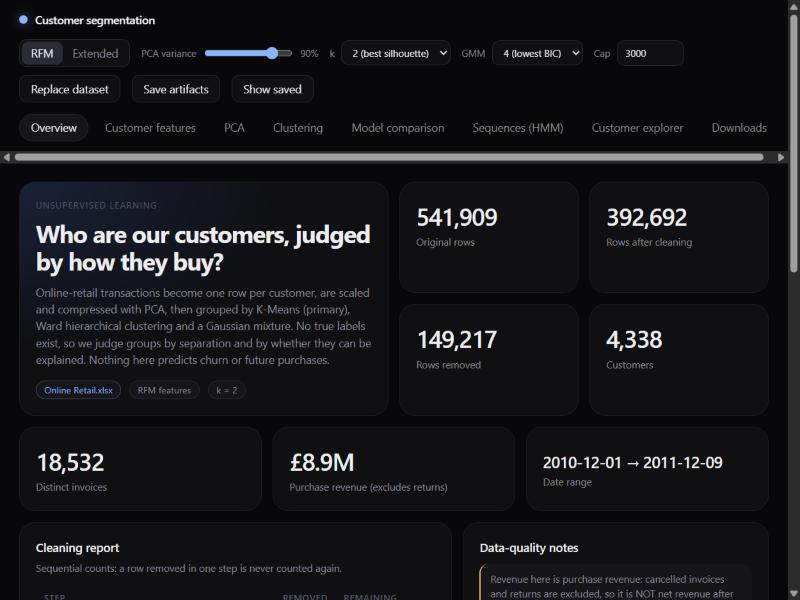
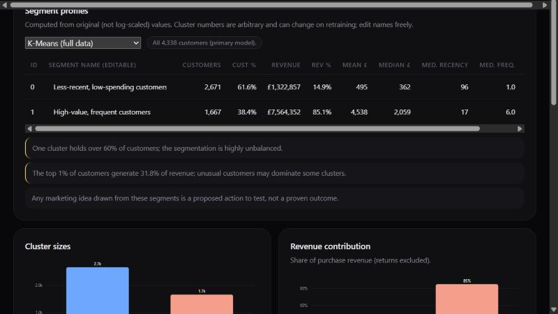
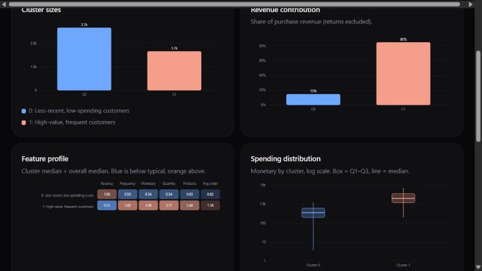
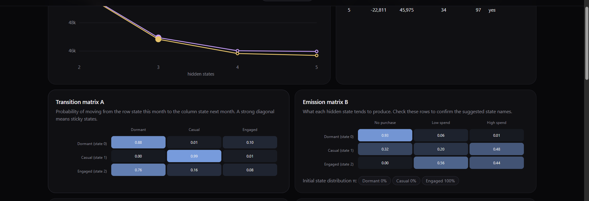
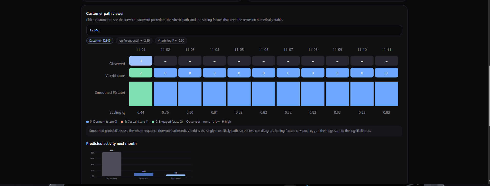

# Customer Segmentation and Engagement HMM

An end-to-end machine-learning project that groups online-retail customers by how they buy, and models how their engagement changes month to month. It runs on the public [UCI Online Retail dataset](https://archive.ics.uci.edu/dataset/352/online+retail) and ships with an interactive dark-mode dashboard (plain HTML, CSS and JavaScript on a small Python server).

- **Segmentation (unsupervised):** raw transactions are cleaned, turned into one profile per customer, log-transformed, standardised and compressed with **PCA**. Three clustering models are trained and compared on the same input: **K-Means** (primary), **Ward hierarchical clustering** and a **Gaussian Mixture Model** (GMM).
- **Sequence modelling:** a **discrete Hidden Markov Model written from scratch in NumPy** (scaled forward–backward, Baum–Welch, Viterbi) describes how customers move between engagement states and predicts next-month activity.
- **Dashboard:** every step is explorable, segment names are editable, and results can be downloaded as CSV.



> **Scope.** The analysis is descriptive. Returns and cancellations are excluded, so revenue here is *purchase revenue*, not net revenue after refunds. The project does not predict churn, and any marketing idea drawn from the segments is a hypothesis to test, not a proven outcome.

---

## Table of contents

1. [Quick start](#quick-start)
2. [Getting the dataset](#getting-the-dataset)
3. [Using the dashboard](#using-the-dashboard)
4. [Using your own data](#using-your-own-data)
5. [What the pipeline does](#what-the-pipeline-does)
6. [Results on the UCI dataset](#results-on-the-uci-dataset)
7. [Hidden Markov Model](#hidden-markov-model)
8. [Using the code from Python](#using-the-code-from-python)
9. [Project structure](#project-structure)
10. [API reference](#api-reference)
11. [Testing](#testing)
12. [Limitations](#limitations)
13. [Troubleshooting](#troubleshooting)
14. [Credits and licence](#credits-and-licence)

---

## Quick start

Requirements: **Python 3.10 or newer** (developed and tested on 3.12). No Node.js or build step is needed.

```bash
# 1. Clone
git clone https://github.com/Ashrafkkhan/HMMmodel.git
cd HMMmodel

# 2. (Recommended) create a virtual environment
python -m venv .venv
source .venv/bin/activate        # Windows: .venv\Scripts\activate

# 3. Install dependencies
pip install -r requirements.txt

# 4. Put the dataset in data/ (see the next section), then start the dashboard
python server.py
```

The dashboard opens at **http://127.0.0.1:8000**. Useful options:

```bash
python server.py --port 8080      # use another port
python server.py --no-browser     # do not open a browser tab
```

**What to expect on first run** (later runs are much faster because results are cached):

| Step | Time on a typical laptop |
|---|---|
| First read of the 23 MB Excel file (then cached as a pickle in `artifacts/`) | about 2.5 minutes |
| First computation after the data loads (PCA, K-Means and GMM sweeps) | about 20 seconds |
| First open of the **Sequences (HMM)** tab (fits 2–5 states) | about 30 seconds |

You can also run the tests without any dataset: `python -m pytest` (see [Testing](#testing)).

## Getting the dataset

The dataset is **not** included in this repository (it is 23 MB and has its own terms of use).

1. Download it from the UCI page: <https://archive.ics.uci.edu/dataset/352/online+retail>
2. The download is a zip archive; extract **`Online Retail.xlsx`**.
3. Place it at:

   ```
   data/Online Retail.xlsx
   ```

   A CSV named `data/Online Retail.csv` with the same columns also works. You can alternatively skip this step and upload a file from the dashboard (**Upload dataset** button).

Required columns:

| Column | Meaning |
|---|---|
| `InvoiceNo` | Invoice number. A leading `C` marks a cancellation. |
| `StockCode` | Product code |
| `Description` | Product name (may be empty) |
| `Quantity` | Units on the line (negative for returns) |
| `InvoiceDate` | Date and time of the invoice |
| `UnitPrice` | Price per unit (GBP) |
| `CustomerID` | Customer number (missing on many rows) |
| `Country` | Customer's country |

If columns are missing, the dashboard shows an error listing exactly which ones.

## Using the dashboard

A row of tabs sits under the top bar. Each tab is a "bento grid" of tiles.

| Tab | What it shows |
|---|---|
| **Overview** | Headline numbers, the sequential cleaning report, data-quality warnings, raw-data preview |
| **Customer features** | Customer table (searchable), feature definitions, summary statistics, distributions with a log-axis option |
| **PCA** | Explained and cumulative variance, component loadings, PC1–PC2 projection |
| **Clustering** | Elbow, silhouette and GMM AIC/BIC charts; K-Means candidate table; editable segment profiles; size, revenue, heat-map, box-plot and scatter charts; Ward dendrogram |
| **Model comparison** | Silhouette, Davies–Bouldin and Calinski–Harabasz for K-Means, Ward and GMM on the same customers, GMM AIC/BIC, cluster-size distributions, trade-offs |
| **Sequences (HMM)** | State-count selection, transition and emission matrices, training curve, engagement mix by month, per-customer path viewer, next-month backtest |
| **Customer explorer** | Look up one customer and compare their features with their segment median |
| **Downloads** | CSV exports (see below) |

**Top-bar controls**

| Control | Effect |
|---|---|
| RFM / Extended | Feature set: Recency, Frequency, Monetary (default) or all six features |
| PCA variance | Fraction of variance PCA must retain (50–99%, default 90%) |
| k | K-Means cluster count (2–8); the recommended value (best silhouette) is marked |
| GMM | Gaussian-mixture component count; the lowest-BIC value is marked |
| Cap | Maximum customers used for the Ward/GMM comparison (default 3,000) |
| Replace dataset | Upload an `.xlsx` or `.csv` |
| Save artifacts / Show saved | Save the fitted scaler, PCA and models, and reload them later without refitting |



**Segment names are editable** in the profile table (cluster numbers are arbitrary and can change when you retrain, so the numeric ID is always shown too). Edited names are remembered in your browser and used in the downloaded files.

**Downloads** (genuine calculated results, built from the same data the pages show):

| File | Content |
|---|---|
| `customer_assignments.csv` | CustomerID, the six features, K-Means cluster and segment name; optionally GMM cluster and maximum membership probability (blank for customers outside the comparison sample) |
| `segment_profiles.csv` | Profiles for every model, with your edited names |
| `model_evaluation.csv` | Internal metrics per model plus GMM AIC and BIC |
| `cleaning_summary.csv` | Sequential cleaning counts and headline dataset numbers |

## Using your own data

Any transaction file with the eight columns above works: upload it from the dashboard or place it in `data/` as `Online Retail.xlsx` / `Online Retail.csv`. Notes:

- Rows without a `CustomerID` cannot be segmented and are dropped (and counted in the cleaning report).
- Rows with an invoice number starting with `C`, non-positive quantity or price, invalid dates, or exact duplicates are removed.
- The reference date for Recency is derived from your data (last invoice date + 1 day), never from today's date.
- The sequence model needs several months of history to be meaningful.

## What the pipeline does

```
Online Retail.xlsx
   -> validate schema -> clean (sequential report)
   -> customer features (Recency, Frequency, Monetary, TotalQuantity, UniqueProducts, AverageOrderValue)
   -> log1p -> StandardScaler -> PCA (smallest number of components reaching the variance threshold)
   -> K-Means (primary), Ward hierarchical, Gaussian mixture, all on the same PCA components
   -> metrics + usefulness checks -> segment profiles in original pounds and days
```

| Stage | Details |
|---|---|
| **Cleaning** | Removes missing customer IDs, cancellations, non-positive quantity/price, invalid dates and duplicates. Counts are sequential so no row is counted twice. `LineRevenue = Quantity x UnitPrice`. |
| **Features** | One row per customer. *Frequency* counts distinct invoices, not lines. Identifiers (`CustomerID`, `InvoiceNo`, `StockCode`) are never model features. |
| **Preprocessing** | `log1p` tames the skew in spend and volume; standardisation puts days and pounds on one scale; PCA removes overlap between features. Segment summaries always use the *original* values. |
| **PCA** | The retained components are the model input. The PC1–PC2 plots are labelled as 2-D projections, since models may use more components. |
| **K-Means** | `KMeans(n_clusters=k, random_state=42, n_init=10)` for k = 2 to 8; recommended k = highest silhouette; user can override. |
| **Ward hierarchical** | Same k as K-Means. Capped at 3,000 customers; above the cap, a reproducible sample is drawn and **all** comparison models are refit on that same sample and clearly labelled. The dendrogram uses a smaller sample (default 300) and assigns no labels. |
| **GMM** | `GaussianMixture(covariance_type="full", random_state=42, n_init=5, reg_covar=1e-6)` for 2 to 8 components; recommended count = lowest BIC. The maximum membership probability is certainty *within the fitted mixture*, not the probability that a business label is correct. |
| **Evaluation** | Silhouette, Davies–Bouldin, Calinski–Harabasz in the shared PCA space; no accuracy/F1 because there are no true labels. Usefulness checks flag tiny, dominant or near-identical clusters and revenue concentration. |
| **Reproducibility** | Fixed seed 42, dataset-relative reference date, optional saved artifacts (scaler, PCA, feature config, models, reference date). |

## Results on the UCI dataset

| Quantity | Value |
|---|---|
| Raw rows to cleaned rows | 541,909 to 392,692 |
| Customers / invoices | 4,338 / 18,532 |
| Purchase revenue | about £8.9 million (Dec 2010 to Dec 2011) |
| PCA | 2 components retain 93.9% of variance (RFM) |
| Recommended k | 2 (silhouette 0.464) |
| Main finding | 38.4% of customers (1,667) generate 85.1% of purchase revenue; they buy a median of 6 times, last bought a median of 17 days before the data end |
| The rest | 61.6% of customers (2,671), median 1 purchase, median recency 96 days |

Model comparison on a shared 3,000-customer sample:

| Model | Clusters | Silhouette | Davies–Bouldin | Calinski–Harabasz |
|---|---|---|---|---|
| K-Means | 2 | **0.464** | **0.825** | **3,419** |
| Ward hierarchical | 2 | 0.449 | 0.845 | 3,286 |
| GMM (same k) | 2 | 0.389 | 0.966 | 2,318 |
| GMM (BIC-selected) | 4 | 0.304 | 1.109 | 1,861 |



K-Means is best on all three internal indices and is the simplest to explain. GMM scores lower because it optimises likelihood, not compactness. The recommended two-cluster solution also triggers two usefulness warnings (one cluster holds over 60% of customers; the top 1% of customers generate 31.8% of revenue), which the dashboard shows rather than hides.

## Hidden Markov Model

The **Sequences (HMM)** tab adds the time dimension (`src/hmm.py`, `src/sequences.py`).

- **Data:** each customer's months from their first purchase to the last *complete* month become a sequence of three symbols: no purchase, low spend, high spend (split at the median positive monthly spend, about £345). A partly observed final month is dropped automatically.
- **Model:** a discrete HMM trained with **Baum–Welch (EM)** from several random starts, with batched, padded NumPy recursions for unequal sequence lengths. States are sorted by expected spend so labels stay stable. 2–5 states are compared by AIC/BIC; the dashboard defaults to 3 for interpretability.
- **Inference:** scaled **forward–backward** (sum-product on a chain), **Viterbi** decoding and next-month prediction. The path viewer shows one customer's observed symbols, Viterbi path, smoothed state probabilities and scaling factors.
- **Backtest:** each customer's last month is hidden and predicted from the earlier months, then compared with a plain Markov chain and a frequency baseline on accuracy and log-loss. The HMM improves log-loss clearly but accuracy only modestly, because about 65% of months are "no purchase".
- **Verified:** tests compare forward probabilities, posteriors and Viterbi paths with brute-force enumeration of every state path.



With three states, the model separates a very persistent **dormant** state, a persistent **steady-buying** state and a short-lived **purchase-burst** state that most customers pass through once. The automatic state names come only from the ordering of expected spend; always check the emission matrix. The model describes engagement and predicts next-month *activity*, not churn.



## Using the code from Python

The ML code in `src/` is independent of the web layer.

```python
from src.data_loader import load_dataset
from src.pipeline import run_pipeline, assignments_table, save_artifacts

raw = load_dataset("data/Online Retail.xlsx")          # validates the schema
result = run_pipeline(raw, feature_set="RFM", variance_threshold=0.90)   # k defaults to best silhouette

print(result["report"])                                # cleaning headline numbers
print(result["profiles"]["K-Means (full data)"])       # segment profiles in original units
print(result["comparison_table"])                      # K-Means vs Ward vs GMM

assignments_table(result).to_csv("customer_assignments.csv", index=False)
save_artifacts(result, "artifacts")                    # scaler, PCA, models, reference date
```

Sequence model:

```python
from src.preprocessing import clean_transactions
from src import sequences as sq

clean, _, _ = clean_transactions(raw)
seqs = sq.prepare_sequences(clean)
rows, models = sq.sweep(seqs)              # fits 2-5 states, returns AIC/BIC per candidate
print(sq.backtest(seqs, k=3)["table"])
```

A walkthrough notebook is in `notebooks/customer_segmentation.ipynb` (run it from the `notebooks/` folder; install Jupyter first with `pip install jupyter`).

## Project structure

```
.
├── server.py                  # HTTP server: serves web/ and the JSON API
├── requirements.txt
├── web/                       # Dashboard (no build step, no external libraries)
│   ├── index.html
│   ├── style.css              # bento grid + dark theme
│   ├── charts.js              # hand-built SVG / canvas charts
│   └── app.js                 # all tabs and application logic
├── src/
│   ├── data_loader.py         # Excel/CSV loading, schema validation, pickle cache
│   ├── preprocessing.py       # cleaning function and sequential report
│   ├── feature_engineering.py # customer features, feature sets, reference date
│   ├── dimensionality.py      # log1p, StandardScaler, PCA, reusable transform
│   ├── clustering.py          # K-Means, GMM, Ward, sweeps, comparison fitting
│   ├── evaluation.py          # metrics and usefulness checks
│   ├── profiling.py           # segment profiles and automatic naming
│   ├── pipeline.py            # orchestration, saved artifacts, exports
│   ├── api.py                 # builds the JSON payload for the dashboard
│   ├── hmm.py                 # NumPy HMM: forward, backward, Baum-Welch, Viterbi
│   ├── sequences.py           # monthly sequences, sweep, backtest, per-customer detail
│   └── visualization.py       # Plotly helpers kept for notebook use
├── tests/                     # 20 pytest tests on a synthetic dataset
├── notebooks/                 # walkthrough notebook
├── data/                      # put the dataset here (not tracked by git)
├── artifacts/                 # caches and saved models (not tracked by git)
└── docs/images/               # screenshots used in this README
```

## API reference

The server listens on `127.0.0.1` only. Responses are strict JSON.

| Method | Endpoint | Description |
|---|---|---|
| GET | `/` | The dashboard |
| GET | `/api/status` | Dataset status (`idle`, `loading`, `ready`, `error`) and whether saved artifacts exist |
| GET | `/api/results` | Segmentation payload. Query: `fs` (RFM or Extended), `thr` (0.5–0.99), `k`, `gmm_k`, `cap`, `dend`, `saved` |
| POST | `/api/upload?name=file.xlsx` | Upload a dataset (raw file bytes as the body) |
| POST | `/api/save` | Save fitted artifacts for the given controls |
| GET | `/api/hmm` | Sequence-model payload. Query: `k` (number of states, 2–5) |
| GET | `/api/hmm_customer` | One customer's forward–backward and Viterbi results. Query: `id`, `k` |

## Testing

```bash
python -m pytest
```

Twenty tests run in about 15 seconds on a synthetic dataset, so **no real data is needed**. They cover schema errors, every cleaning rule and the sequential counts, feature definitions (invoices not lines, dataset-relative recency), identifiers excluded from features, finite model input, PCA retention, same-customer comparisons, reproducible sampling, artifact round-trips, strict-JSON payloads, and the HMM against brute-force enumeration.

## Limitations

- Revenue is purchase revenue: returns and cancellations are excluded, so this is not a profitability or returns-aware analysis. (Example: customer 12346's 74,215-unit order was cancelled minutes later but still counts here.)
- The data covers about one year from one retailer; Recency is measured against the last date in the data, not today.
- Customers without a `CustomerID` (about 25% of raw rows) cannot be segmented.
- Segments describe past behaviour. "Dormant" is not "churned", and nothing here proves that a marketing action will work.
- The recommended k = 2 is the cleanest but coarsest split; finer segmentations (for example k = 4) score lower on internal metrics.
- Ward and GMM comparisons run on a sample when the dataset exceeds the cap.
- The HMM reduces monthly spend to three symbols, observes only 12 months, and assumes a first-order Markov process. The number of states is a judgement call.
- The server is built for a single local user: no authentication, database or multi-user state.

## Troubleshooting

| Problem | Fix |
|---|---|
| Dashboard says "No dataset loaded" | Put `Online Retail.xlsx` (or `.csv`) in `data/` and restart, or use **Upload dataset** |
| "Missing required column(s)" | Your file lacks one of the eight required columns; the message lists them |
| First start is very slow | Excel parsing takes about 2.5 minutes once; afterwards the cached pickle in `artifacts/` is used |
| HMM tab shows a 404 error | A server from an older version is still running; stop it and restart `python server.py` |
| `Address already in use` | Another process uses port 8000; run `python server.py --port 8080` |
| HMM tab unavailable with "Show saved" | The sequence model needs the loaded dataset; switch back to live results |
| Warning about physical CPU cores on Windows | Harmless (joblib); set `LOKY_MAX_CPU_COUNT` to silence it |

## Credits and licence

- Dataset: Chen, D., Sain, S. L. and Guo, K. (2012), *Data mining for the online retail industry: A case study of RFM model-based customer segmentation using data mining*, Journal of Database Marketing & Customer Strategy Management, 19(3). Obtained from the [UCI Machine Learning Repository](https://archive.ics.uci.edu/dataset/352/online+retail); please check that page for the dataset's terms of use.
- Built with pandas, NumPy, scikit-learn and SciPy. The dashboard uses no third-party JavaScript.
- Developed as a Machine Learning course project (Units 3 and 4: mixture models and EM, PCA and clustering; hidden Markov models).
- **Licence:** no licence file is included yet. Add one (for example MIT) before others reuse or redistribute the code.
